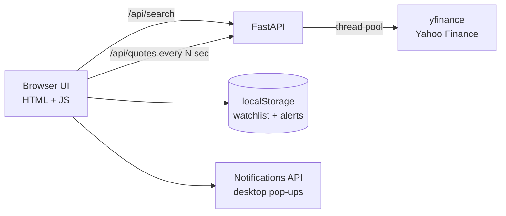

<div align="center">

# 📈 StockPulse

**Pick any stocks. Watch them live. Get a pop-up the moment they move.**

A real-time stock watchlist web app with per-stock price alerts and desktop notifications.


</div>

---

## ✨ Features

- 🔎 **Search anything:** stocks, ETFs, indices, crypto (`Apple`, `NVDA`, `^GSPC`, `BTC-USD`).
- ⚡ **Live prices:** auto-refresh every 5s / 15s / 1m, with green/red flash on every tick.
- 📉 **Intraday sparkline** per stock, plus day range and previous close.
- 🔔 **Per-stock alerts:** set *above* / *below* targets on each card.
- 🚀 **Big-move pop-ups:** get notified when a stock moves ±0.5% / 1% / 2% on the day.
- 🖥️ **Desktop notifications:** alerts reach you even in another tab.
- 💾 **Remembers your watchlist & alerts:** no account needed.

## 🖼️ Preview

> _Add a screenshot: `docs/screenshot.png`_

```
┌──────────────────────┐ ┌──────────────────────┐ ┌──────────────────────┐
│ NVDA              ✕  │ │ AAPL              ✕  │ │ BTC-USD           ✕  │
│ $142.10              │ │ $228.45              │ │ $91,240              │
│ ▲ 4.70 (+3.42%)      │ │ ▼ 1.20 (-0.52%)      │ │ ▲ 1,820 (+2.04%)     │
│ ╱╲╱‾‾╲╱‾‾‾‾╱         │ │ ‾‾╲╱╲__╱╲_           │ │ _╱‾╲╱‾‾╱‾‾           │
│ [↑ 150] [↓ 135]      │ │ [↑ 235] [↓ 220]      │ │ [↑ 95000] [↓ ]       │
└──────────────────────┘ └──────────────────────┘ └──────────────────────┘
                                         🔔 NVDA 🚀 up 3.42% today · Now $142.10
```

## 🏗️ Architecture



- **Parallel quotes:** a thread pool fetches all symbols at once.
- **Zero build step:** one HTML file, no React or npm.
- **Alert logic client-side:** fires once per crossing, no spam.

## 🚀 Run it

```bash
git clone https://github.com/MananMaini/stock-pulse.git
cd stock-pulse
pip install -r requirements.txt
python app.py
```

Or on macOS just double-click **`run.command`** (sets everything up and opens the browser).

Open **http://127.0.0.1:8000**, search a stock, then click **🔔 Enable desktop pop-ups**.

## 📡 API

| Endpoint | Example |
|---|---|
| `GET /api/search?q=apple` | Symbol lookup |
| `GET /api/quotes?symbols=AAPL,NVDA` | Price, change, day range, intraday series |

## 🗺️ Roadmap

- [ ] WebSocket streaming instead of polling
- [ ] Email / SMS / Discord alert channels
- [ ] Candlestick charts with technical indicators
- [ ] Portfolio mode: holdings, cost basis, P&L
- [ ] One-click deploy (Render / Railway)

## 👤 Author

**Manan Maini** · Business Analytics + CS @ Ithaca College
[LinkedIn](https://linkedin.com/in/mainimanan) · [GitHub](https://github.com/MananMaini)

⭐ Star the repo if you find it useful!

> Not financial advice. Data from Yahoo Finance via yfinance; may be delayed.
