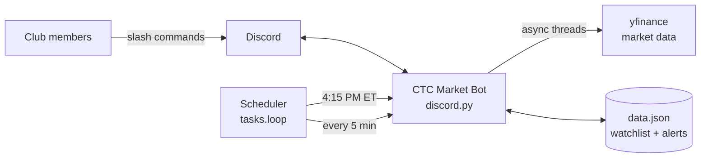

<div align="center">

# 📈 CTC Market Bot

**A Discord bot that turns your investment club's server into a live trading desk.**

Shared watchlists · Price alerts · Automatic daily market-close reports


</div>

---

## 💡 Why

Built for **Core Trading Consultants (CTC)**, a student investment group in Ithaca, NY.
Analysts were juggling Yahoo Finance tabs, group chats and spreadsheets to track pitches.
This bot puts the whole club's watchlist, alerts and daily recap **inside the Discord server everyone already uses.**

## ✨ Features

| Command | What it does |
|---|---|
| `/price AAPL` | Live price + daily % change |
| `/watch add NVDA` | Add to the shared club watchlist |
| `/watch remove NVDA` | Remove from watchlist |
| `/watch list` | Watchlist with live prices, 🟢/🔴 |
| `/alert BIIB above 300` | Pings you when the target is hit |
| `/alerts` | All active alerts |
| ⏰ **Daily Close** | Top 3 gainers & losers posted at **4:15 PM ET** automatically |

## 🖼️ Preview

```
📊 CTC Daily Close
Top gainers
🟢 NVDA  $142.10 (+3.42%)
🟢 BIIB  $187.55 (+1.98%)
🟢 AMZN  $214.30 (+1.12%)
Top losers
🔴 TSLA  $251.40 (-2.75%)
🔴 NFLX  $689.20 (-1.31%)
🔴 DIS   $96.85  (-0.64%)

🔔 @Manan BIIB $190.02 (+1.32%) hit your target $190.00
```

## 🏗️ Architecture



- **Non-blocking:** yfinance calls run in `asyncio.to_thread`, so the bot never freezes.
- **Concurrent quotes:** watchlist prices fetched in parallel with `asyncio.gather`.
- **Timezone-aware scheduling:** daily report pinned to New York market close.
- **Zero-infra persistence:** JSON file; easy to swap for SQLite/Postgres.

## 🚀 Quick start

```bash
git clone https://github.com/MananMaini/ctc-market-bot.git
cd ctc-market-bot
pip install -r requirements.txt
cp .env.example .env      # add DISCORD_TOKEN + CHANNEL_ID
python bot.py
```

**Create the bot:** [Discord Developer Portal](https://discord.com/developers/applications) → New App → Bot → copy token →
OAuth2 → URL Generator → scopes `bot` + `applications.commands` → permissions *Send Messages*, *Embed Links* → invite.

**Run 24/7 free:** Railway, Render, Fly.io, or a Raspberry Pi.

## 🗺️ Roadmap

- [ ] Earnings-calendar reminders for watchlist names
- [ ] Weekly club portfolio P&L report with charts
- [ ] Per-ticker news headlines + sentiment score
- [ ] Pitch tracker: log a pitch, track its return since pitch date
- [ ] SQLite storage + Docker image

## 🤝 Contributing

PRs welcome. Open an issue for ideas or bugs.

## 👤 Author

**Manan Maini** · Business Analytics @ Ithaca College · Junior Analyst @ CTC
[LinkedIn](https://linkedin.com/in/mainimanan) · [GitHub](https://github.com/MananMaini)

⭐ If your club finds this useful, star the repo!

> Not financial advice. Market data from Yahoo Finance via yfinance, may be delayed.
